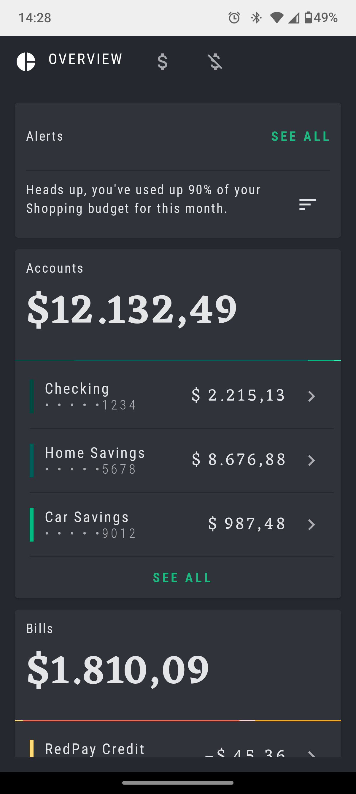
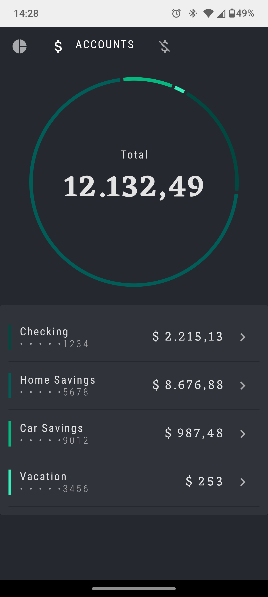
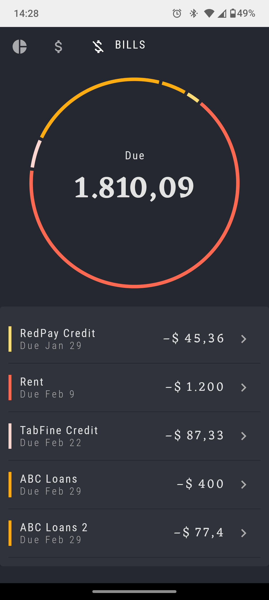
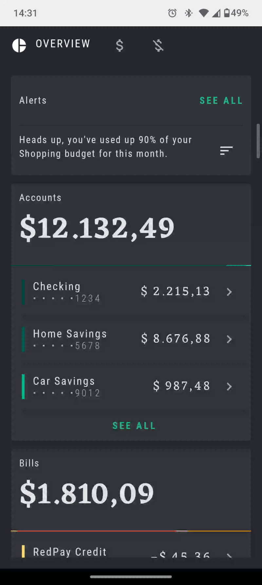

# Rally App (Navigation Compose)

Este repositório contém a implementação prática desenvolvida durante o codelab [**Navegação no Jetpack Compose**](https://developer.android.com/codelabs/jetpack-compose-navigation?hl=pt-br#0), disponibilizado pelo Google.

A aplicação simula um painel financeiro pessoal e utiliza a biblioteca **Navigation Compose** para estruturar a navegação entre diferentes telas (Visão Geral, Contas, Faturas e Detalhes), gerenciando a pilha de navegação, argumentos de rota e estado da interface de forma reativa.

## Tecnologias e Ferramentas Utilizadas

- **Linguagem:** Kotlin
- **UI Framework:** Jetpack Compose (Material Design 3)
- **Biblioteca de Navegação:** Navigation Compose (`NavController`, `NavHost`, `composable`)
- **Arquitetura de UI:** Single-Activity Architecture com Jetpack Compose
- **Testes de UI:** Compose UI Test Framework (`createAndroidComposeRule`)
- **IDE:** Android Studio
- **Mínimo SDK:** API level 21+

## Conceitos e Aprendizados Práticos

Durante a evolução deste projeto e do codelab de navegação, os seguintes conceitos foram consolidados:

### 1. Configuração e Mapeamento de Rotas (`RallyDestinations`)
- Mapeamento centralizado e seguro das rotas de navegação da aplicação através de contratos bem definidos.
- Suporte a destinos com e sem argumentos dinâmicos (ex.: navegação para detalhes de uma conta específica).

### 2. Estrutura de Navegação com `NavHost` e `NavController`
- Centralização da lógica de navegação em um composable dedicado (`RallyNavHost`).
- Uso do `NavController` para efetuar transições de tela, gerenciar a *back stack* e evitar acúmulo desnecessário de destinos na memória com rotas de limpeza (`popUpTo` e `launchSingleTop`).

### 3. Integração de Navegação por Abas (`RallyTabRow`)
- Sincronização entre a barra de navegação personalizada do Rally (`RallyTabRow`) e o estado atual do `NavController` utilizando escuta de rotas ativas (`currentBackStackEntryAsState`).

### 4. Passagem e Extração de Argumentos
- Configuração de argumentos de navegação do tipo `NavType.StringType` para exibição de telas de detalhes customizadas a partir de seleções nas listas de contas e faturas.

### 5. Testes Automatizados de Navegação (`NavigationTest`)
- Escrita de testes instrumentados para validar se as interações de clique na interface acionam corretamente as transições de rota e carregam as telas esperadas.

## Evidências do Projeto (Demonstração Prática)

### 1. Telas Principais da Aplicação

| Visão Geral (Overview) | Contas (Accounts) | Faturas (Bills) |
| :---: | :---: | :---: |
|  |  |  |

---

### 2. Fluxo Interativo de Navegação (GIF)

| Transição entre Abas e Detalhes via Navigation Compose |
| :---: |
|  |

## Como Executar o Projeto

1. Clone o repositório:
   ```bash
   git clone https://github.com/leticia-farias/compose-training-navigation-rally.git
2. Abra o projeto no Android Studio.
3. Aguarde o término da sincronização do Gradle.
4. Execute a aplicação em um emulador ou dispositivo físico (API 21+).
5. Para rodar os testes de navegação, execute a classe NavigationTest localizada no diretório androidTest.
